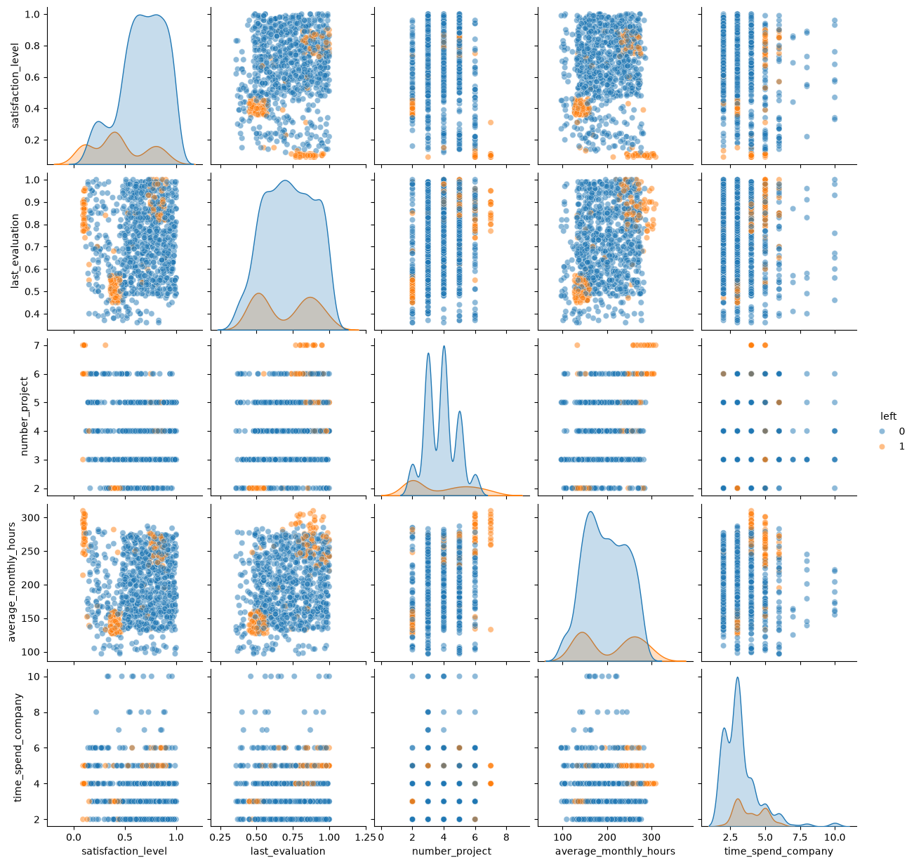
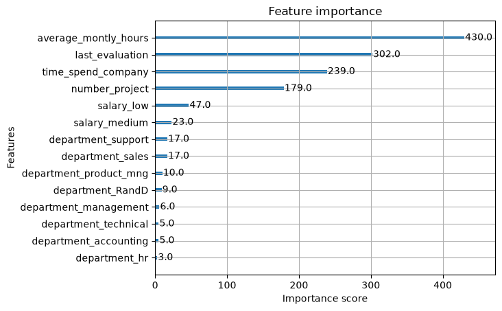

# Predictive Workforce Analytics: Forecasting Employee Attrition with XGBoost
    A strategic initiative commissioned by Salifort Motors HR to identify turnover drivers and enhance employee satisfaction.

| | |
|---|---|
|**_Issue / Problem_**   Salifort employee notices high rate of turnover and want to improve employee satisfaction levels at the company and is concerned with the time and resources spent during recruitment.  They want to know which factors are likely to make employees leave the company to increase retention and to be cost efficient by reducing resources spent in recruitment processes  **_Response_** Salifort Motors Leadership Team: - Instructed HR department to conduct a survey to a sample of employees Data Professional (Me): - Built an XGBoost predictive model for forecasting employee attrition - Evaluate model to determine its efficacy and predictive power  **_Impact_** The model helps predict whether an employee will leave and identify factors that contribute and influential to employee attrition. The insights found in this model enables human resource and leadership to make data-driven decisions to reduce turnovers and improve employee satisfaction| 
---
**_Key Insights_**
* Employees who left displays 3 distinct clusters
    - Underperforming, underhours, disgruntled employee
    - Overworked, highperforming, disgruntled employees
    - Overworked, highperforming, satisfied employees

* There are 4 factors that are highly influential to employee attrition
    - Employee average monthly hours
    - Last evaluation
    - Tenure
    - Number of Projects

* High employee satisfaction level increases employee retention

* Employees with 4 - 6 years tenure:
    - Contributes with 4 or more projects
    - Renders 230 or more monthly average hours

**_Suggestions_** 
* Implement employee max project to reduce employee workload
    - Analysis shows employees with high workload tend to leave company 
* Implement maximum daily work hour
    - High work hours indicates high employee attrition 
* Establish employee performance improvement program for underperforming employees
    - Offers employee career development reducing employee attrition
* Offer career progression programs for senior level employees (tenure of 4 - 6 years)
    - Senior level employees (Tenure 4 - 6 years) have high turnover, offering career options or promotions to increase tenured employee retention
* Re-evealuate employee performance evaluation criteria to base on employee work quality
    - Average rendered hours doens't indicate quality performance
    - Change evaluation metrics from average monthly hours to work quality and contributions.